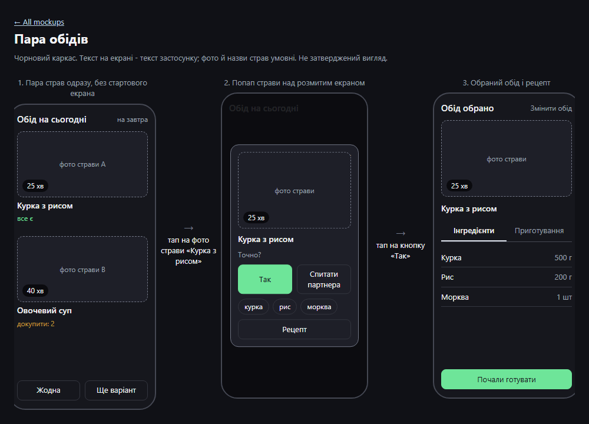
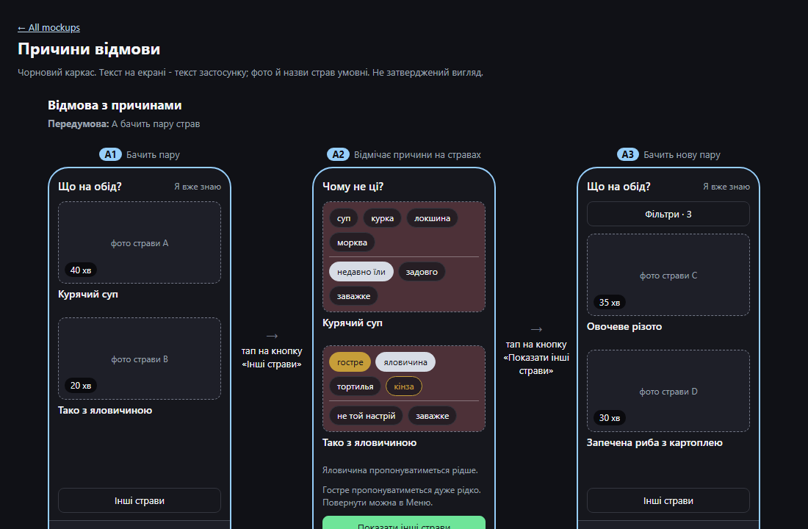
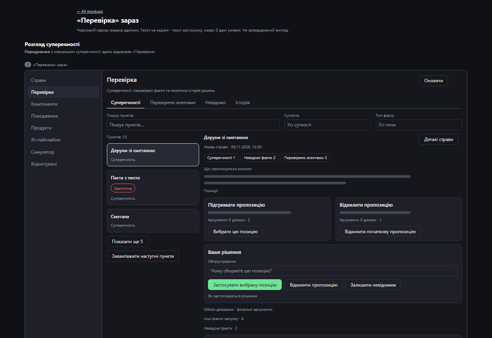
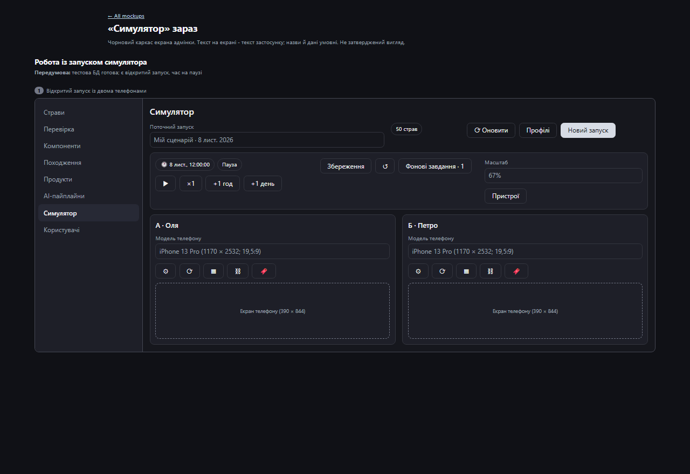
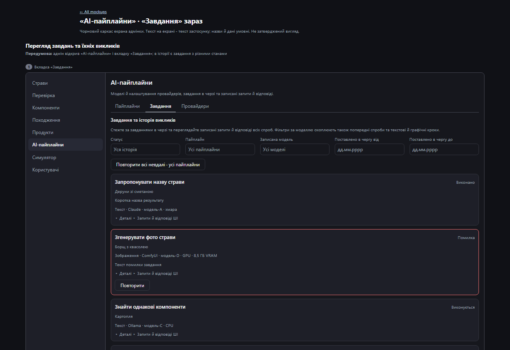
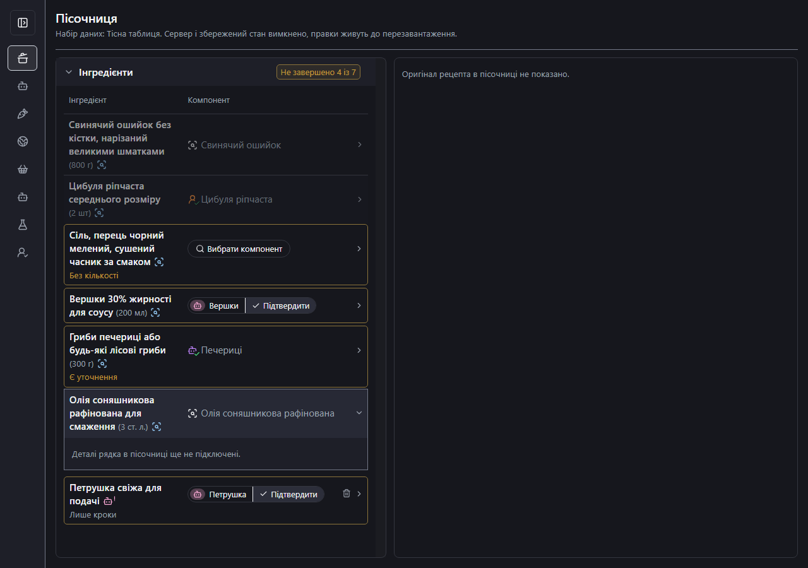
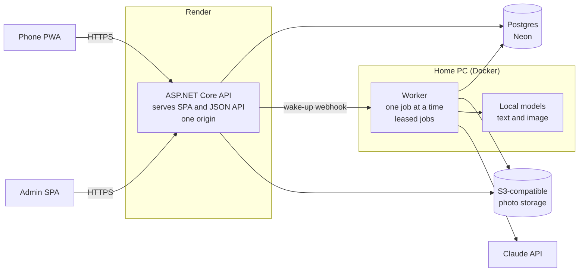

# Zhratva

Zhratva is a personal web app (PWA) for a couple. It answers one daily question: "what do we cook for lunch?" The app builds the choices from real recipes, and the two people only pick, reject or rate. The problem it targets is choice fatigue, not a lack of recipes. Choosing between two dishes is easier than inventing one.

The current version is for home use: Rostyslav and his girlfriend use it to make everyday life a bit easier. It is not a commercial project, at least for now. It has an admin side for desktop (catalogue, review, AI jobs, simulator) and a phone side for the daily lunch.

**Status:** the admin side works. The phone lunch app is partly built. There is no public demo.

**Code:** the repository is private. This page is a showcase only: what the product is and how it is built, without the core code. A code walkthrough is available on request in an interview.

## Screenshots

The interface is in Ukrainian (the users' language). Code and docs are in English.

The images below come from design mockups and from a backend-free design page. They use made-up demo data. They are drafts, not accepted final UI.

*Phone mockup: two dishes at once, tap one to open it, then choose, ask the partner, or open the recipe.*

*Phone mockup: when a dish is rejected, the user taps the reasons (ingredient, mood, time). The app uses them for later suggestions.*

*Admin mockup: the Review screen. Disputed facts, facts checked by agents, and a permanent history of decisions. A person makes the final call.*

*Admin mockup: the Simulator. Two phones for two people, with a controllable clock, so the two-person flow can be tried by one developer.*

*Admin mockup: the AI jobs view. Each job shows its status, the provider and model, the recorded requests and answers, and a manual retry.*

*Real admin components on prepared data (no backend): a raw ingredient line on the left, the catalogue component it links to on the right. AI suggestions wait for a person to confirm.*

## Features

Phone (daily use):

- On first launch the user marks allergies and disliked foods. Allergies are a hard filter.
- Every day the app shows a pair of dishes. A double tap chooses one.
- The user can ask the partner, replace a dish, or give reasons for a rejection.
- Recipe view with cooking steps and ingredient marks.
- Rating and an own photo of the cooked lunch.
- Two optional games (a tournament between dishes, sorting raw recipes) that give the app more taste data. The app works without them.
- One-tap undo. The partner's tastes are used only with consent.

Admin (desktop):

- Dish catalogue with drafts and dish types.
- Review of disputed and unknown facts, with an immutable decision history.
- Ingredient tree, origins and products.
- AI pipelines and a job queue with recorded model calls.
- The simulator for the two-person flow.
- Users and QR invitations for new phones.

Product rules: dishes come from real recipes, and the AI never invents a dish.

## Architecture

- **API and SPA on one origin.** The ASP.NET Core API serves the React app and the JSON API, so there is no CORS setup. The admin uses a cookie session. Real phones and the simulator phones use two separate bearer schemes. Database migrations run on startup.
- **Separate worker.** All slow and paid work (AI calls, photo generation) runs in a separate process. It takes one job at a time under a lease, cancels an attempt after a time limit, and does not retry by itself. The API wakes it with a webhook, and it also polls.
- **Postgres** holds all data through EF Core. A second database holds simulator data.
- **Photos** are stored outside Postgres in a private S3-compatible bucket. The API streams the bytes. A deletion queue cleans up unused objects.
- **Providers** sit behind interfaces: Claude models for text, a local text model, a local image model for dish photos. There is no silent fallback to a paid provider.
- **Deployment.** The API runs on Render, the database on Neon, and the worker in Docker on a home computer (it has the GPU). CI is on GitHub Actions. The worker is deployed by a self-hosted runner.
- **Logging.** Structured JSON logs (Serilog), with an optional Seq sink.

## Stack

- Backend: C#, .NET 10, ASP.NET Core, EF Core, Npgsql, Serilog, AWS S3 SDK, SkiaSharp (photo processing).
- Database: PostgreSQL.
- Frontend: React 19, TypeScript, Vite, React Router, Vitest, oxlint. Two entry points: admin and phone.
- Tools: Python (recipe analysis helpers), PowerShell dev scripts.
- Infra: Docker, Docker Compose, GitHub Actions, Render, Neon, S3-compatible storage.
- AI: Claude models, a local text model, a local image model.

## How it is tested

- **Integration tests** run the API in-process (`WebApplicationFactory`) against a real PostgreSQL in a Testcontainers container, not an in-memory fake. They cover recipes, ingredients, jobs, dishes, photos, auth and migrations.
- **Unit tests** (xUnit) cover pure logic. Tests are tagged by kind and by domain, and a script runs one slice, for example only integration tests of the jobs domain.
- **Migration tests** check that the schema upgrades cleanly.
- **Architecture guard.** A regression test fails if any AI provider skips the audited transport.
- **Frontend tests** (Vitest) cover the logic layer: API clients, state and review helpers.
- **Simulator.** The real mobile UI and the real rules run against a separate database, with scripted outcomes of background jobs and a controllable clock. Time-based flows between two people can be tested by one person.
- **CI** (GitHub Actions) builds the backend, and lints and builds the frontend, on pushes and pull requests to the main branch. The test suites are not run in CI; they run locally before a change is accepted.

## Engineering decisions

- **Code first, AI second, for ingredient linking.** Exact names, stem matching and a word-forms list link about 79% of raw ingredient lines with no model call. A cheap model and a checker raise it to about 90%. On one measured run over about 22 thousand lines from about 2.5 thousand recipes, the whole linking cost about 1.3 USD. A change to a rule or prompt is accepted only if the same recipe sample does not get worse.
- **AI output is untrusted.** Models must answer in a fixed structure that is checked against a schema. Code filters the answer, and a human decision is never overwritten. The AI cannot add anything to the catalogue until a person accepts it.
- **Every model call leaves evidence.** One transport writes each request before it is sent and each raw answer before it is parsed, in separate database scopes, so failed attempts keep their trace. A test blocks any bypass.
- **No automatic retries.** A retry repeats paid calls, so a person decides. The lease makes a lost attempt end as failed instead of hanging as running.
- **A simulator instead of a second tester.** The app is for two people. The simulator runs two phones and a clock in one admin screen against its own database.

## How it was built

Rostyslav sets the goals, makes the product and design decisions, defines the checks and reviews the result. The code is written by AI coding agents that follow his own process. That process is published as a Claude Code plugin: [ClaudeDevKit](https://github.com/KoroVaik/ClaudeDevKit).

The repository keeps docs next to the code: feature files with acceptance rules, a glossary and written reasons for engineering choices. They let the agents work to the same rules between sessions.
